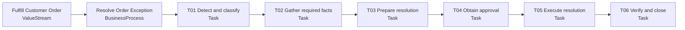

# Order Exception Process Definition

Status: Conceptual, non-normative example

`VS-FULFILL-CUSTOMER-ORDER` realizes value by accepting, producing, and fulfilling a customer order. `PROC-RESOLVE-ORDER-EXCEPTION` is one process within that value stream. Its outcome is a blocked order that is either safely released, explicitly rejected, or escalated to an accountable authority.

| Task | Accountable responsibility | Permitted participation |
|---|---|---|
| `TASK-OE-DETECT` | Coordinate order exception | Human or agent observes and classifies |
| `TASK-OE-GATHER` | Coordinate order exception | Human or agent observes and prepares |
| `TASK-OE-PREPARE` | Coordinate order exception | Human or agent recommends and prepares |
| `TASK-OE-APPROVE` | Applicable approval responsibility | Authorized human approves or rejects |
| `TASK-OE-EXECUTE` | Coordinate order exception | Authorized human or agent executes; systems act only through a binding invoked by the performer |
| `TASK-OE-VERIFY` | Coordinate order exception | Human or agent verifies and closes or escalates |

The definition and its running instances are separate. `PROCINST-OE-2026-0042` concerns order `ORD-2026-0173`; its task instances carry execution state without changing the process definition. Dependencies, sequence, hierarchy, and responsibility assignments are modeled as separate `ProcessRelationship` documents rather than inferred from this display order; `PREL-OE-PROCESS-CONTAINS-DETECT` and `PREL-OE-APPROVE-PRECEDES-EXECUTE` are the instantiated examples. Task instances `TASKINST-OE-0042-DETECT` through `TASKINST-OE-0042-VERIFY` record the June 18 execution. `TASKINST-OE-0042-APPROVE` was due by 19:00 and started at 17:05; had it not started by then, it would have been escalated to the Credit Manager position accountable for `RESP-APPROVE-CREDIT-EXCEPTION` (CHR-PROC-010).

`OM-OE-RESOLUTION-TIME` measures the process outcome: the median hours from block to resolution, where a decrease is the improvement, against a target of 4. Its baseline of 26 hours was observed over 2026-Q1 and cites `EVR-OE-RESOLUTION-BASELINE`. Because that window ended before `ASGN-OEC-ORDER-EXCEPTION-SUPPORT` began on April 1, the coordinator may prepare and execute this process's tasks (CHR-PROC-009).

An exception record identifies the affected process and task instance, violated expectation, responsible escalation target, and required disposition. Example branches include bounded execution, approval-gated execution, separation-of-duties rejection, stale approval, and ambiguous external outcome.
