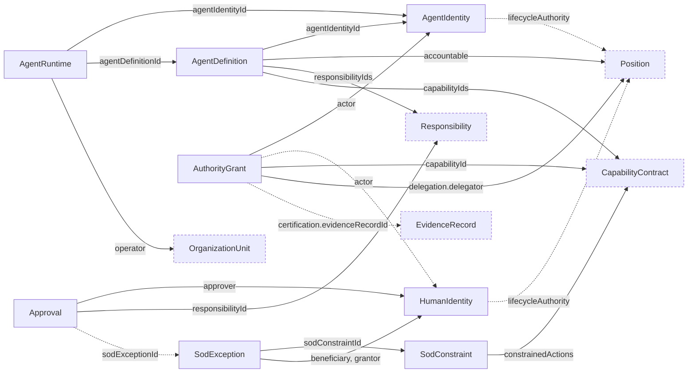

# Agent Schemas

Schemas for the `CHR-ID`, `CHR-AGENT`, and `CHR-AUTH` domains: `human_identity`, `agent_identity`, `agent_definition`, `agent_runtime`, `authority_grant`, `approval`, `sod_constraint`, and `sod_exception`, plus `authority_explanation`, the named format of an explanation of an authority decision (CHR-AUTH-013), which is not a Charter document.

Identity, definition, grant, and approval are separate documents; an agent definition must declare purpose, triggers, inputs, outcomes, capabilities, policies, and escalation conditions, and may declare, like any document, `derivedFrom` provenance (CHR-AGENT-010, CHR-CONF-015) and `operatingLimits` that a runtime may add to but never widen (CHR-AGENT-011). A grant may carry a `certification` that suspends it once overdue (CHR-AUTH-011). A `SodException` relieves one actor of one constraint for a bounded period; it counts only where an approval or action names it in `sodExceptionId` (CHR-AUTH-012).

## Relations

Dashed nodes belong to other domains.