# Charter relational model

Status: Implemented. The tables are keel schema modules in [`sdk/schema/`](../sdk/schema/), and the keel adapter's `DocumentStore` reads and writes them.

The model stores every catalogued document kind in its own PostgreSQL tables, in Boyce-Codd normal form. Modeled object references are declared foreign keys; provenance identifiers that intentionally name another document set remain external. The JSON documents of the specification remain the interchange format. An import decomposes a document into rows, and an export rebuilds it from them.

## Conventions

### Tenant

Every table carries `partner_id`, a foreign key path to keel `business_partner`. It leads every primary key, unique key, and foreign key, so no row can reference another tenant's row. The diagrams omit `partner_id` to stay readable. Read every key shown as prefixed by it. The one exception is keel `currency`, which is global and is referenced by its code alone.

### Platform tables

These tables are the governance record the specification defines. A platform that runs agents keeps its own tables for releases, runs, approval work items, delegation bounds, and its audit log. It references a Charter row by its `enterprise_object` id or through `enterprise_object_external_identifier`, and never copies a Charter document into its own rows. This model holds nothing about turns, runs, releases, tools, knowledge, or models.

### Identity

`enterprise_object` gives every document one surrogate `id` from `enterprise_object_seq`. The id is unique by namespace and identifier within the tenant. The row also records the two facts about a document that never change: its kind and its enterprise. Every kind table is a subtype, and its `id` is a foreign key to `enterprise_object`. The service writes a document's content only in the table of its kind.

A reference to an object outside the document set (`external: true`, such as a `WorkContext`) is registered as an `enterprise_object` of kind `XO` with its `external_kind`. That gives external targets a key too.

### References

| Reference in the schema | Column shape | Target |
|---|---|---|
| To one kind | `<role>_id` | the kind table, or its identity table for a versioned kind |
| To one of a closed set of kinds | one nullable `<role>_<kind>_id` per admitted kind, exactly one set | each kind's table |
| A list whose members may be of several kinds | one child table per admitted kind | each kind's table |
| To any kind, or to an external object | `<role>_id` | `enterprise_object` |
| To an exact definition version | `<role>_id` and `<role>_version_no` | the kind's version table |

An idRef string and a namespaced idRef resolve to the same row. Export writes the string form when the target shares the referring document's namespace.

### Versions

The specification versions eight kinds: AgentDefinition, BusinessProcess, Task, CapabilityContract, CapabilityBinding, DataBinding, AuthorityBinding, and EventBinding. Each has an identity table named for the kind and a `<kind>_version` table keyed by `version_no`.

- A version row and its children are written once and never updated.
- The current version is the highest `version_no`.
- The declared version label, such as `processDefinitionVersion`, is stored once, in `enterprise_object_version.definition_version`, and is unique per object.
- A fact that cannot change between versions lives on the identity table, not on the version table.

Every other kind is mutable. It has one kind table updated in place and exactly one `enterprise_object_version` row with `version_no` 1. Updates through this adapter are not recorded by keel's table change logger.

`enterprise_object_version` holds the envelope every document carries: specification version, name, description, lifecycle state, and validity.

### Normalization

Every table is in Boyce-Codd normal form. Every determinant is a candidate key, so a fact is stored in one row of one table. These are the decisions that keep it so:

- **No copied kinds.** A reference never stores its target's kind next to its id, because the id determines the kind. A restricted reference uses one column per admitted kind instead.
- **Enterprise once.** CHR-ENT-001 puts every organizational object in exactly one enterprise. The store refuses a change of enterprise, and the enterprise boundary rule keeps every reference inside its enterprise. In a kind table, a referenced object would therefore determine the enterprise, so the enterprise is stored only on `enterprise_object`.
- **Agent identity once.** An agent definition belongs to one agent identity across all its versions. A runtime keeps its definition for its life and acts as that definition's identity. An agent's action is that runtime's identity's action. So only `enterprise_agent_definition` stores the identity, and the runtime and the action derive it.
- **Nothing derived.** No digest of content, and no flag that repeats which value column is set.
- **Records keep what was in force.** A mediation decision records its profile's stage and policies, and an action records the approved capability or action class it evaluated. The profile and the approval are mutable, so these values describe the moment of the record. Deriving them from the current row would rewrite history, so they are not dependencies.

### Lists and nested objects

- **One table per array property.** Each array property of a kind becomes a child table keyed by its owner. An array of objects with its own arrays gets grandchild tables.
- **Shared tables for shared definitions.** An array of a definition from `common.schema.json` gets one table across all owner kinds, keyed by `enterprise_object_version`. These tables are `enterprise_object_limit`, `binding_feature_support`, `evidence_requirement`, `enterprise_object_external_identifier`, `enterprise_object_source_evidence`, `enterprise_object_extension`, and `identity_lifecycle_transition`. The service admits only the owner kinds whose schema has the property.
- **Sets and sequences.** A set, meaning `uniqueItems` or a list whose members are identified by a natural key, is keyed by that member. An ordered list carries `ordinal`.
- **Single nested objects.** A required nested object becomes columns of its owner. An optional nested object without lists becomes nullable columns with an all-or-none CHECK. An optional nested object with lists of its own becomes a one-to-zero-or-one child table.
- **Constants.** A property fixed by `const`, such as `unpreservableConstraintBehavior` or `actEffective`, carries no information. It is written on export, not stored.

### Minimum counts

A required array with a minimum item count becomes a rule the service checks on save, because a child table cannot require its own rows. An optional array with a minimum is either absent or non-empty, and no rows exports as absent, so it needs no check.

| Owner | Rule |
|---|---|
| Agent definition version | At least one responsibility, capability, trigger, required input, expected outcome, policy, escalation condition, and confidence boundary |
| Task version | At least one performer kind |
| Capability contract version | At least one outcome and one evidence requirement |
| Separation of duties constraint | At least two constrained capabilities and responsibilities together |
| Assignment criterion | At least one value |
| Roadmap item | At least one gap |
| Outcome measure with a baseline | At least one baseline evidence record |
| Information definition | At least one governance policy; with a shape, at least one property and one identity property; with a fact authority, at least one fact source |
| Information governance policy | At least one scope object, permitted use, access constraint, and retention rule |
| Mediation profile | At least one scope agent, capability, or information definition; at least one attribute trust; declared outcomes include allow |
| Binding version and binding conformance | At least one feature support |
| Data binding version | At least one field mapping |
| Binding conformance and conformance claim | At least one tested rule and one verification type; a claim has at least one result |
| Evidence bundle | At least one record across its four record tables |

### Codes

Every enumeration is a keel `constant_header` and `constant_value` list with 1-character codes, or 2-character codes where the list needs them. Each referencing column has a CHECK listing exactly those codes. Export maps each code back to the specification's word. Each module section lists its codes.

### Opaque content

Two kinds of content are open-ended by specification: extension values and embedded JSON Schemas. They are decomposed too.

- **JSON values.** An arbitrary JSON value is a tree of `json_value` rows, one per object, array, or scalar, with its member name or item index. Extension values, fact values, and the literals inside a JSON Schema use it.
- **JSON Schema.** An embedded JSON Schema is a tree of `json_schema_node` rows, one per subschema, linked through the applicator keyword that holds it. Each node has a typed column per assertion keyword. Keywords the 2020-12 vocabularies do not define, such as `x-charter-ref-kinds`, and keywords whose value a typed column cannot hold exactly, are kept whole in `json_schema_annotation`, so the decomposition is lossless.

### Canonical round trip

Export produces the canonical form of a document. It is equal in meaning to what was imported, not identical byte for byte.

- Sets are written in key order and sequences in `ordinal` order.
- An optional array or object that is empty is written as absent. A required array is written even when it is empty, such as an approval's limits and conditions, a grant's limits, a contract's inputs, or a decision's subject lists.
- A same-namespace reference is written as a string.
- A saved document whose canonical form equals the stored one is a replay.

### Write order

A save inserts the `enterprise_object` row of every document in the batch first, then content rows in foreign-key order. Self-references, such as a parent unit or a superseded record, require the parent first. A cycle among them is already invalid under the acyclicity rules. Evidence is appended on its own, so a document whose optional property cites evidence that names the document, such as a measure whose baseline cites a measurement of it, is saved without that property first and completed once the evidence is stored.

## Core

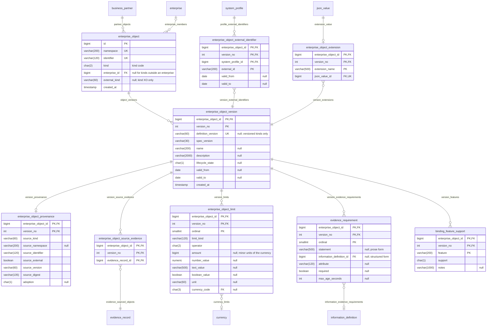

| Table name | Description |
|---|---|
| `enterprise_object` | Identity of every document and external object: its namespace, identifier, kind, and enterprise. |
| `enterprise_object_version` | Envelope of one document version: definition version label, specification version, name, description, lifecycle state, and validity. |
| `enterprise_object_provenance` | The document of another document set that a version was derived from, with its version and digest. |
| `enterprise_object_extension` | One namespaced extension property of a version, with its value as a JSON value tree. |
| `enterprise_object_external_identifier` | The key an object carries in an external system profile, effective for a validity period. Owner kinds: OU, PT, PO, RL, HI. |
| `enterprise_object_source_evidence` | An evidence record that a version rests on. Owner kinds: EN, OU, PT, PO, RL, RS, OR, AS, VS, BP, TK, PR, CC, AT, GP, RM. |
| `enterprise_object_limit` | A machine-comparable limit of a version: kind, operator, exactly one typed value, and an optional unit or currency. Owner kinds: AD, AR, AG, AP, CC. |
| `binding_feature_support` | Declared support of a binding or binding conformance for one contract feature. |
| `evidence_requirement` | Evidence a task or capability contract version rests on, as prose or as a required information attribute with a maximum age. |

- `enterprise_object` has two partial unique keys. Documents are unique by namespace and identifier. External objects are unique by namespace, external kind, and identifier.
- The `enterprise_id` of an Enterprise row is null. Kinds the schema places outside an enterprise, such as bindings and the work vocabulary, also leave it null. The column references `enterprise_object`, not `enterprise`, because the Enterprise row is itself an `enterprise_object` and a foreign key to the subtype would make the two tables depend on each other; the service checks that the target's kind is EN.
- `enterprise_object_provenance.source_*` names a document of another document set. By specification it is never resolved within this set (CHR-CONF-015), so it is deliberately not a foreign key.
- A limit has exactly one value column set. `amount` is set exactly when `currency_code` is set. A CHECK enforces both.
- A limit's currency is a foreign key to keel `currency`, the only source of exponents. The specification's `currencyExponent` is written on export from that table, and an import whose exponent disagrees is refused.
- An external identifier's validity periods never overlap per object and system profile. An exclusion constraint enforces this.

### Kind codes

| Code | Kind | Code | Kind | Code | Kind |
|---|---|---|---|---|---|
| EN | Enterprise | AP | Approval | ES | EnterpriseSystem |
| OU | OrganizationUnit | SC | SodConstraint | SP | SystemProfile |
| PT | PositionType | SX | SodException | CB | CapabilityBinding |
| PO | Position | VS | ValueStream | DB | DataBinding |
| RL | Role | BP | BusinessProcess | AB | AuthorityBinding |
| RS | Responsibility | TK | Task | EB | EventBinding |
| OR | OrganizationRelationship | PR | ProcessRelationship | BC | BindingConformance |
| AS | Assignment | PI | ProcessInstance | ID | InformationDefinition |
| HI | HumanIdentity | TI | TaskInstance | IG | InformationGovernancePolicy |
| AI | AgentIdentity | CC | CapabilityContract | MP | MediationProfile |
| AD | AgentDefinition | AT | ArchitectureState | MD | MediationDecision |
| AR | AgentRuntime | GP | Gap | ER | EvidenceRecord |
| AG | AuthorityGrant | RM | RoadmapItem | AC | ActionRecord |
| WC | WorkClassification | OM | OutcomeMeasure | XR | ExceptionRecord |
| WK | WorkConcept | CL | ConformanceClaim | EL | Escalation |
| XO | External object | | | BU | EvidenceBundle |

### Core codes

| Column | Codes |
|---|---|
| `lifecycle_state` | P proposed, L planned, A active, S suspended, R retired |
| `adoption` | A adopted, T tailored |
| `operator` | LT lt, LE lte, EQ eq, GE gte, GT gt |
| `support` | S supported, P partial, U unsupported |

## JSON values and JSON Schema

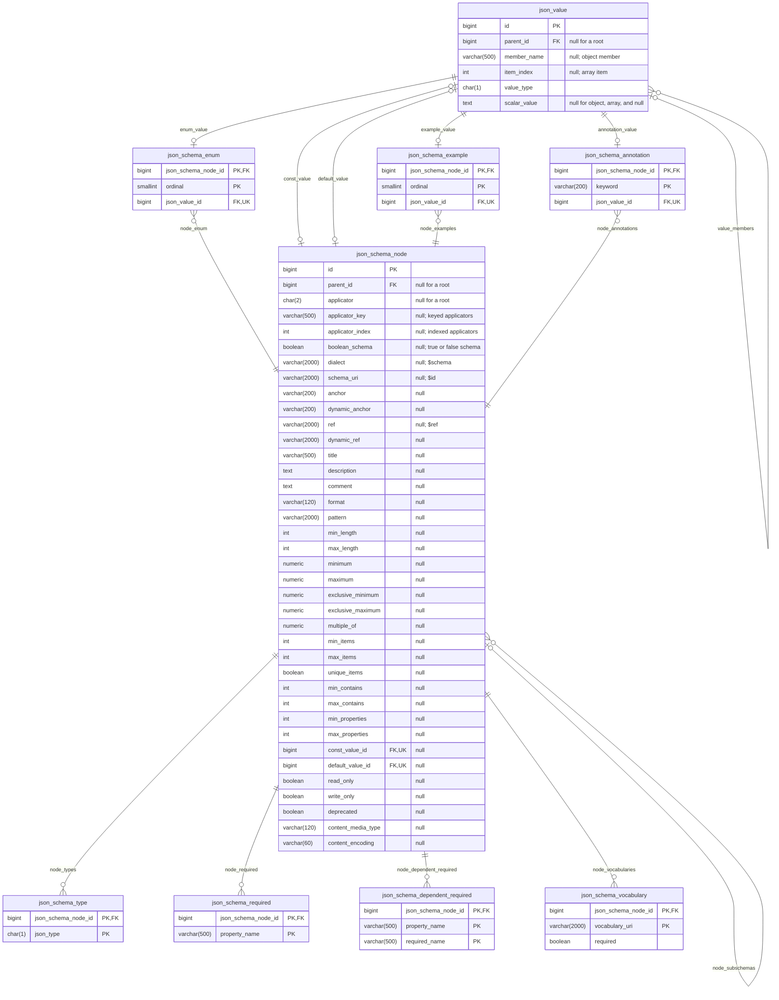

| Table name | Description |
|---|---|
| `json_value` | One node of a JSON value tree: an object, array, or scalar with its member name or item index. |
| `json_schema_node` | One subschema of an embedded JSON Schema, with the applicator that holds it and a column per assertion keyword. |
| `json_schema_type` | One permitted JSON type of a schema node. |
| `json_schema_required` | One required property name of a schema node. |
| `json_schema_dependent_required` | A property a schema node requires when another named property is present. |
| `json_schema_enum` | One permitted value of a schema node's enumeration. |
| `json_schema_example` | One example value of a schema node. |
| `json_schema_vocabulary` | One vocabulary a metaschema node declares, and whether it is required. |
| `json_schema_annotation` | One keyword outside the 2020-12 vocabularies, such as an x-charter annotation, with its value. |

- A `json_value` has exactly one of a member name, an item index, or no parent. Member names are unique per parent object, and item indexes per parent array.
- `value_type` is the only statement of a value's type. `scalar_value` holds a string's text, a number in JSON notation, or `true` or `false`. It is null exactly for objects, arrays, and null. A CHECK enforces the form for each type.
- A child `json_schema_node` names the applicator keyword that holds it. Keyed applicators use `applicator_key`, and indexed applicators use `applicator_index`.
- Sequences come from `json_value_seq` and `json_schema_node_seq`.
- Each root is owned by exactly one row elsewhere, such as an extension, a fact, or a contract's input schema. A unique key on each owning column enforces this. A save deletes a root it replaces.

| Column | Codes |
|---|---|
| `json_value.value_type` | O object, A array, S string, N number, B boolean, Z null |
| `json_schema_type.json_type` | O object, A array, S string, N number, I integer, B boolean, Z null |
| `applicator` | PR properties, PP patternProperties, AP additionalProperties, PN propertyNames, DS dependentSchemas, UP unevaluatedProperties, IT items, PI prefixItems, CT contains, UI unevaluatedItems, AL allOf, AN anyOf, OO oneOf, NT not, IF if, TH then, EL else, DF $defs, CS contentSchema |

Keyed applicators are PR, PP, DS, and DF. Indexed applicators are PI, AL, AN, and OO.

## Enterprise

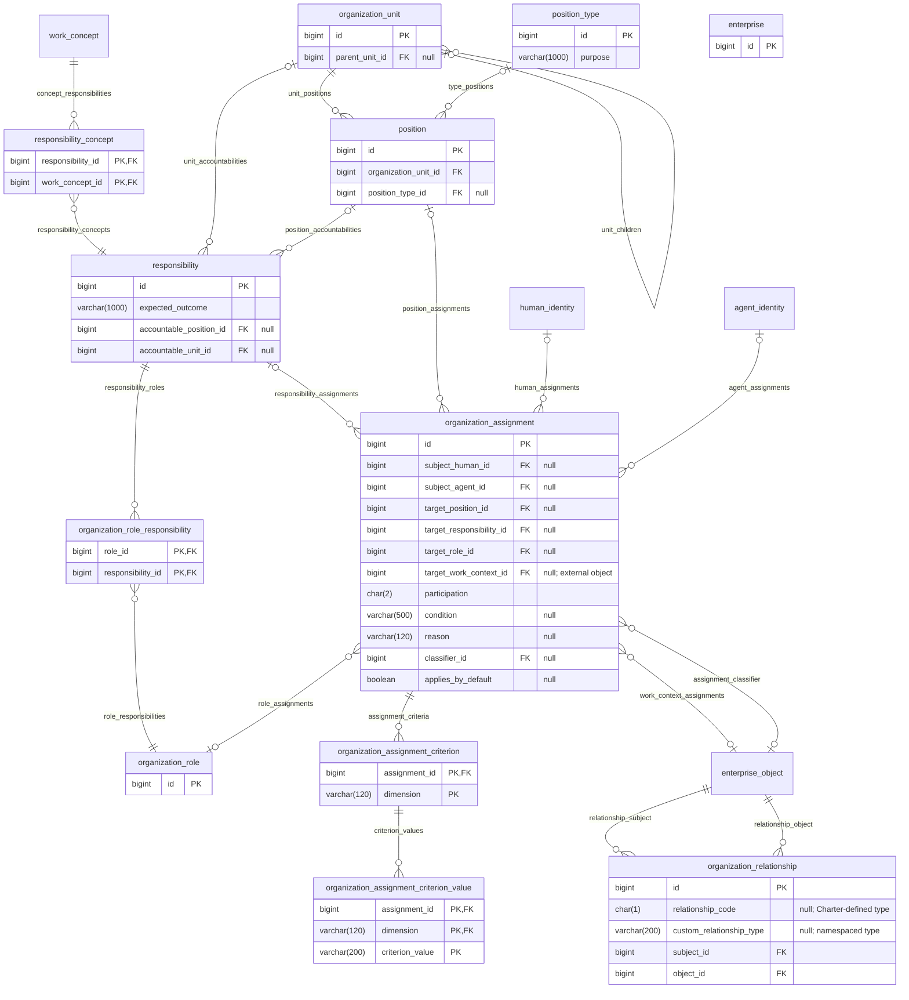

| Table name | Description |
|---|---|
| `enterprise` | The enterprise every organizational object belongs to. |
| `organization_unit` | A unit of the organization tree, with its parent unit. |
| `position_type` | A reusable kind of position and its purpose. |
| `position` | A position in an organization unit, optionally of a position type. |
| `organization_role` | A reusable business role that bundles responsibilities. |
| `organization_role_responsibility` | A responsibility a role carries. |
| `responsibility` | An expected outcome and the position or unit accountable for it. |
| `responsibility_concept` | A work concept a responsibility cites. |
| `organization_relationship` | A typed relationship between two organizational objects, Charter-defined or namespaced. |
| `organization_assignment` | Assignment of a human or agent to a position, responsibility, role, or work context, with its participation. |
| `organization_assignment_criterion` | One dimension an assignment matches on. |
| `organization_assignment_criterion_value` | One value of an assignment criterion dimension. |

- A responsibility is accountable to exactly one of a position or a unit. An assignment has exactly one subject and exactly one target. CHECKs enforce these.
- An assignment whose participation is `occupies` has a human subject and a position target. A CHECK enforces this. A work-context target is an external object of external kind `WorkContext`, which the service checks.
- An organization relationship has exactly one of a Charter-defined code or a namespaced custom type. A CHECK enforces this.

| Column | Codes |
|---|---|
| `relationship_code` | R reports-to, D deputy-of, C coordinates-with |
| `organization_assignment.participation` | OC occupies, SU supports, OB observes, RC recommends, PP prepares, AP approves, PF performs, EX executes |
| `process_task_participation.participation`, `process_task_instance.participation` | OB observes, RC recommends, PP prepares, AP approves, EX executes, from the assignment list |

## Work

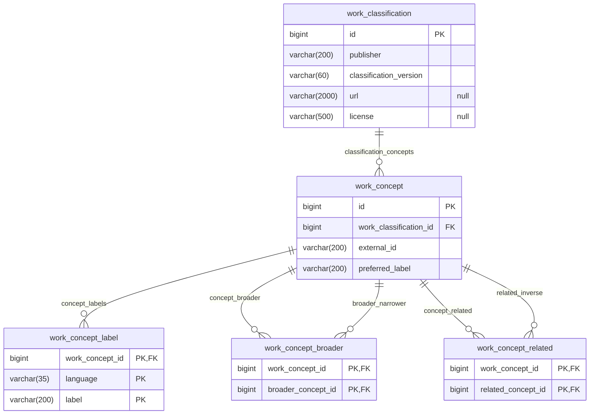

| Table name | Description |
|---|---|
| `work_classification` | An external classification of work, with its publisher, version, and license. |
| `work_concept` | A concept of a work classification, with its external identifier and preferred label. |
| `work_concept_label` | An alternative label of a work concept in one language. |
| `work_concept_broader` | A broader concept of a work concept. |
| `work_concept_related` | A related concept of a work concept. |

## Agent

### Identities and definitions

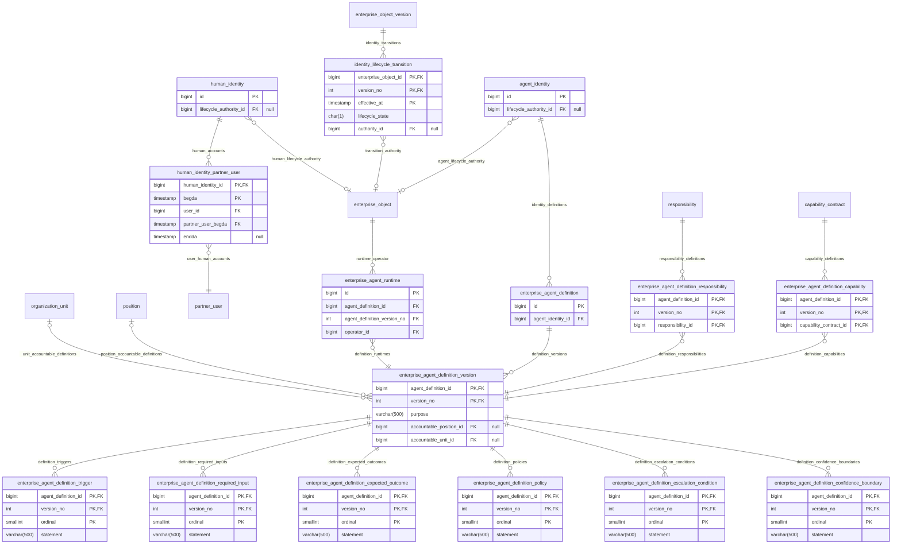

| Table name | Description |
|---|---|
| `human_identity` | A human identity and the authority for its lifecycle. |
| `agent_identity` | An agent identity and the authority for its lifecycle. |
| `identity_lifecycle_transition` | One effective lifecycle state change of a human or agent identity, kept to evaluate past actions. |
| `human_identity_partner_user` | The keel partner user membership a human identity is linked to for a period. |
| `enterprise_agent_definition` | An agent definition and the agent identity it belongs to across all its versions. |
| `enterprise_agent_definition_version` | One immutable version of an agent definition: purpose and accountable position or unit. |
| `enterprise_agent_definition_responsibility` | A responsibility an agent definition version serves. |
| `enterprise_agent_definition_capability` | A capability contract an agent definition version may use. |
| `enterprise_agent_definition_trigger` | A trigger statement of an agent definition version, in order. |
| `enterprise_agent_definition_required_input` | A required input statement of an agent definition version, in order. |
| `enterprise_agent_definition_expected_outcome` | An expected outcome statement of an agent definition version, in order. |
| `enterprise_agent_definition_policy` | A policy statement of an agent definition version, in order. |
| `enterprise_agent_definition_escalation_condition` | A condition under which an agent definition version escalates, in order. |
| `enterprise_agent_definition_confidence_boundary` | A confidence boundary of an agent definition version, in order. |
| `enterprise_agent_runtime` | A running instance of one agent definition version and the object operating it. |

- `human_identity_partner_user` links a human identity to a keel `partner_user` membership. Its membership key references keel `partner_user`, and its start is not earlier than the membership's. Exclusion constraints keep its periods from overlapping per human and per user.
- An agent definition keeps its agent identity across versions, and a runtime keeps its definition for its life. The store refuses a save that changes either one, and a runtime whose `definitionVersion` names no stored version. A runtime's `agentIdentityId` is then always its definition's identity (CHR-AGENT-006), so export derives it.
- A definition version is accountable to exactly one of a position or a unit. A CHECK enforces this.
- Operating limits of a definition version and of a runtime are rows of `enterprise_object_limit`.

### Authority and separation of duties

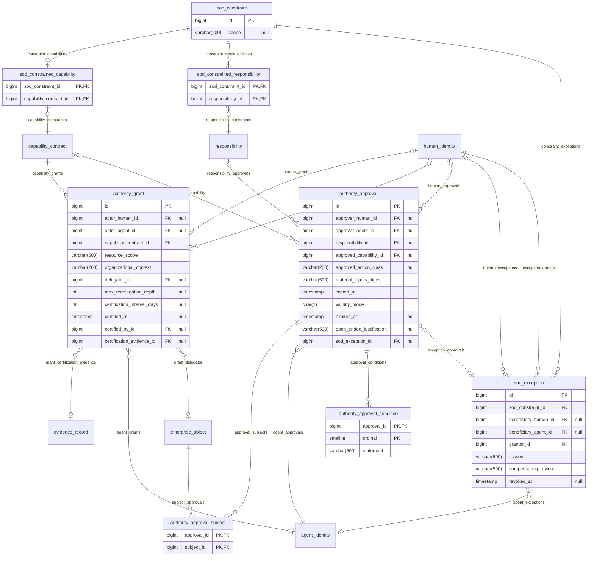

| Table name | Description |
|---|---|
| `authority_grant` | Authority a human or agent holds over a capability, scope, and context, with delegation and certification. |
| `authority_approval` | An approval a human or agent issued for one capability contract or action class on given material inputs, with its validity. |
| `authority_approval_subject` | An object an approval applies to. |
| `authority_approval_condition` | A condition statement attached to an approval, in order. |
| `sod_constraint` | A separation of duties constraint and its scope. |
| `sod_constrained_capability` | A capability contract a separation of duties constraint covers. |
| `sod_constrained_responsibility` | A responsibility a separation of duties constraint covers. |
| `sod_exception` | An exception to a separation of duties constraint for one beneficiary, with its grantor and compensating review. |

- A grant's actor, an approval's approver, and an exception's beneficiary are each exactly one human or agent. CHECKs enforce these.
- Delegation, meaning the delegator and the redelegation depth, is all or none. Certification, meaning the interval, time, certifier, and evidence, is all or none. CHECKs enforce both.
- An approval approves exactly one of a capability contract or an action class. A CHECK enforces this. The specification's `approvedAction` is the capability's identifier or the class: an import stores the capability when the string names a capability contract stored in the document's namespace, and the class otherwise.
- `expires_at` is present exactly when `validity_mode` is expires-at. `open_ended_justification` is present exactly when it is open-ended. A CHECK enforces this.
- `constrainedActions` is split by target kind into two tables.
- Grant and approval limits are rows of `enterprise_object_limit`.
- AuthorityExplanation is an evaluation output format, not a stored document, so it has no table.

| Column | Codes |
|---|---|
| `identity_lifecycle_transition.lifecycle_state` | P proposed, A active, S suspended, R retired, from the core lifecycle list |
| `validity_mode` | E expires-at, O open-ended |

## Process

### Value streams, processes, and tasks

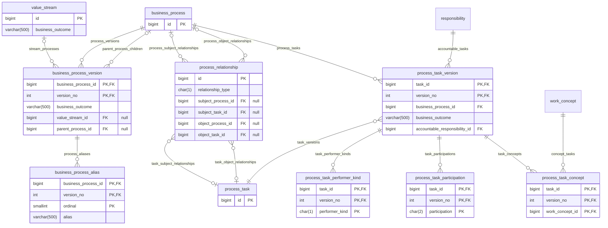

| Table name | Description |
|---|---|
| `value_stream` | A value stream and the business outcome it delivers. |
| `business_process` | Identity of a business process across its versions. |
| `business_process_version` | One immutable version of a business process: outcome, value stream, and parent process. |
| `business_process_alias` | An alternative name of a business process version, in order. |
| `process_task` | Identity of a task across its versions. |
| `process_task_version` | One immutable version of a task: its process, outcome, and accountable responsibility. |
| `process_task_performer_kind` | A kind of performer, human or agent, a task version admits. |
| `process_task_participation` | A participation a task version admits. |
| `process_task_concept` | A work concept a task version cites. |
| `process_relationship` | A typed relationship between two processes or tasks. |

- A relationship has exactly one subject and exactly one object. A CHECK enforces this.
- A task's evidence requirements are rows of `evidence_requirement`.

### Capability contracts

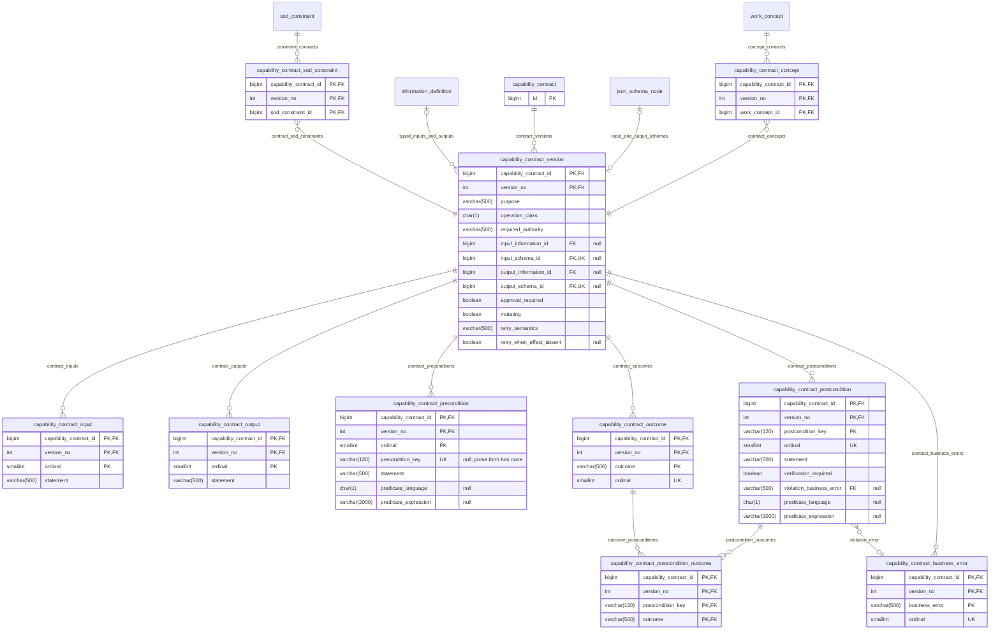

| Table name | Description |
|---|---|
| `capability_contract` | Identity of a capability contract across its versions. |
| `capability_contract_version` | One immutable version of a capability contract: operation class, authority, schemas, and retry semantics. |
| `capability_contract_input` | An input statement of a contract version, in order. |
| `capability_contract_output` | An output statement of a contract version, in order. |
| `capability_contract_outcome` | An outcome a contract version declares. |
| `capability_contract_business_error` | A business error a contract version declares. |
| `capability_contract_precondition` | A precondition of a contract version, as prose or a keyed predicate. |
| `capability_contract_postcondition` | A keyed postcondition of a contract version, with its predicate and violation error. |
| `capability_contract_postcondition_outcome` | A declared outcome a postcondition applies to. |
| `capability_contract_sod_constraint` | A separation of duties constraint a contract version is subject to. |
| `capability_contract_concept` | A work concept a contract version cites. |

- Inputs and outputs are each typed by at most one of an information definition or an embedded JSON Schema root. A CHECK enforces this.
- A postcondition applies to declared outcomes and may name a declared business error (CHR-CAP-009). Both are foreign keys into the same contract version.
- A predicate's language and expression are all or none. A CHECK enforces this.
- Constraint limits are rows of `enterprise_object_limit`, and evidence requirements are rows of `evidence_requirement`.
- A contract version with postconditions must be mutating. The service enforces this because it spans two tables.

### Instances

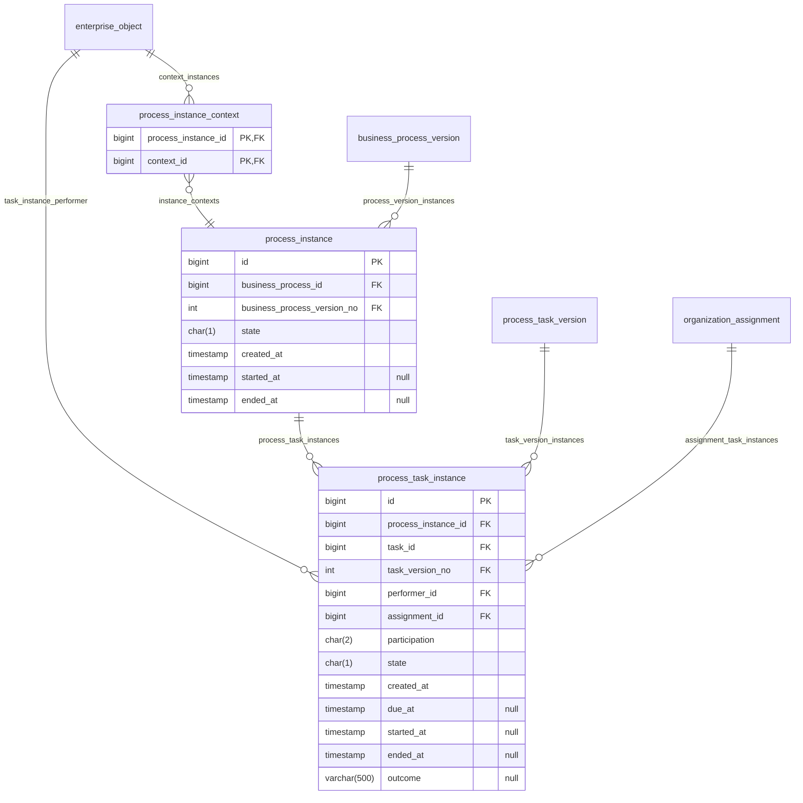

| Table name | Description |
|---|---|
| `process_instance` | One run of a business process version, with its state and times. |
| `process_instance_context` | An object that forms the context of a process instance. |
| `process_task_instance` | One run of a task version in a process instance, with its performer, assignment, state, and outcome. |

- An instance pins the exact definition version it runs, so `processDefinitionVersion` and `taskDefinitionVersion` are foreign keys to version rows. Export writes their labels. An instance whose label names no stored version is refused.
- A task instance's participation is its own fact. CHR-PROC-008 bounds it by its assignment's level but does not fix it.

### Architecture and outcome measures

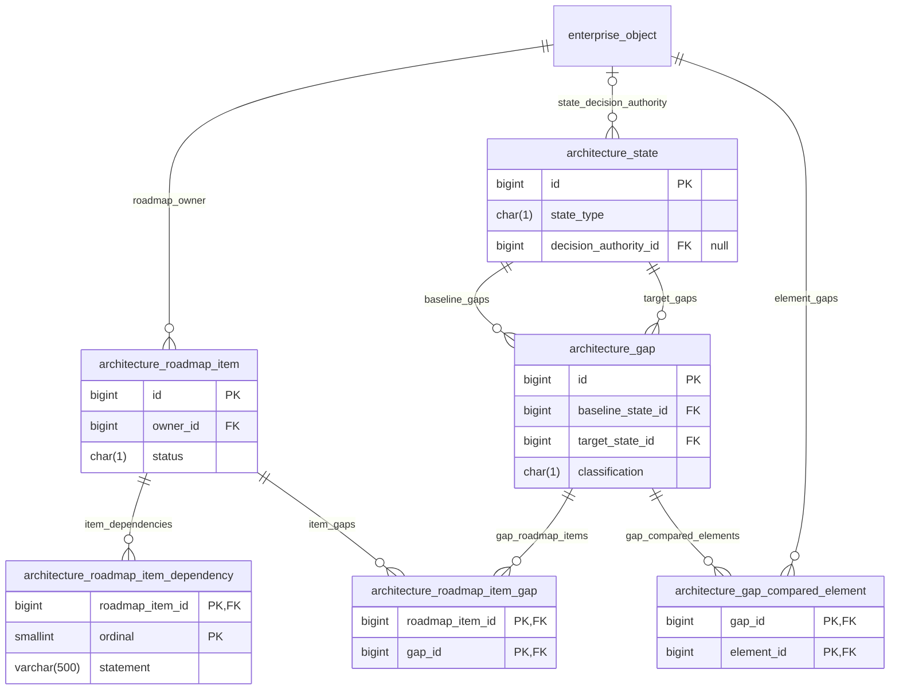

| Table name | Description |
|---|---|
| `architecture_state` | A baseline or target architecture state and its deciding authority. |
| `architecture_gap` | A missing, changed, or retired difference between a baseline and a target state. |
| `architecture_gap_compared_element` | An object a gap compares. |
| `architecture_roadmap_item` | Planned work that closes gaps, with its owner and status. |
| `architecture_roadmap_item_gap` | A gap a roadmap item closes. |
| `architecture_roadmap_item_dependency` | A dependency statement of a roadmap item, in order. |

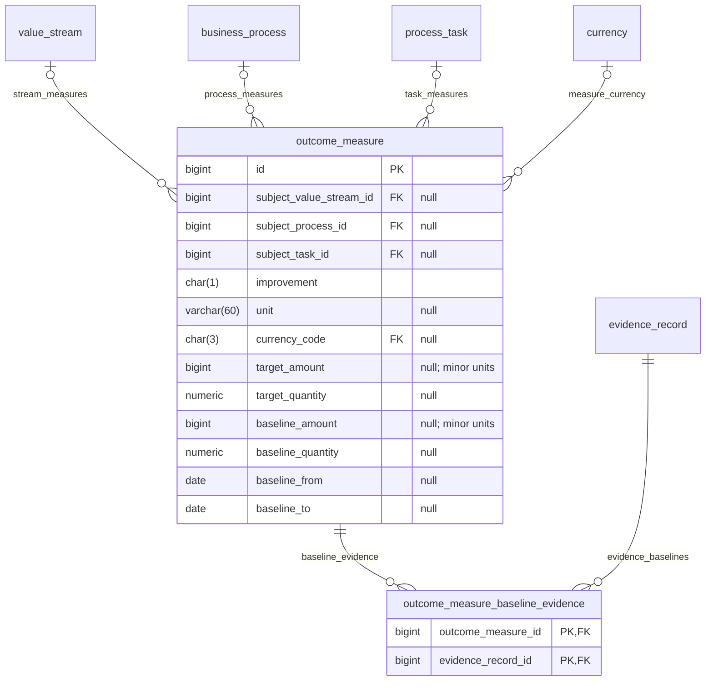

| Table name | Description |
|---|---|
| `outcome_measure` | A measure of a value stream, process, or task, with its improvement direction, target, and baseline. |
| `outcome_measure_baseline_evidence` | An evidence record a measure's baseline rests on. |

- A measure has exactly one subject. It has a unit, a currency, or both. CHECKs enforce these.
- A measure with a currency uses the amount columns in integer minor units, and one without uses the quantity columns. A CHECK enforces this.
- The baseline value and window are all or none. A CHECK enforces this.

| Column | Codes |
|---|---|
| `process_relationship.relationship_type` | C parent-child, P precedes, D depends-on |
| `process_task_performer_kind.performer_kind` | H human, A agent |
| `operation_class` | R read, P propose, A approve, E execute |
| `predicate_language` | C cel |
| `process_instance.state` | P proposed, R running, S suspended, C completed, X cancelled, F failed |
| `process_task_instance.state` | P pending, R running, S suspended, C completed, X cancelled, F failed, E escalated |
| `state_type` | B baseline, T target |
| `architecture_gap.classification` | M missing, C changed, R retired |
| `architecture_roadmap_item.status` | P proposed, A approved, I implementing, V validating, C completed, X cancelled |
| `improvement` | I increase, D decrease |

## Binding

### Systems and capability, authority, and event bindings

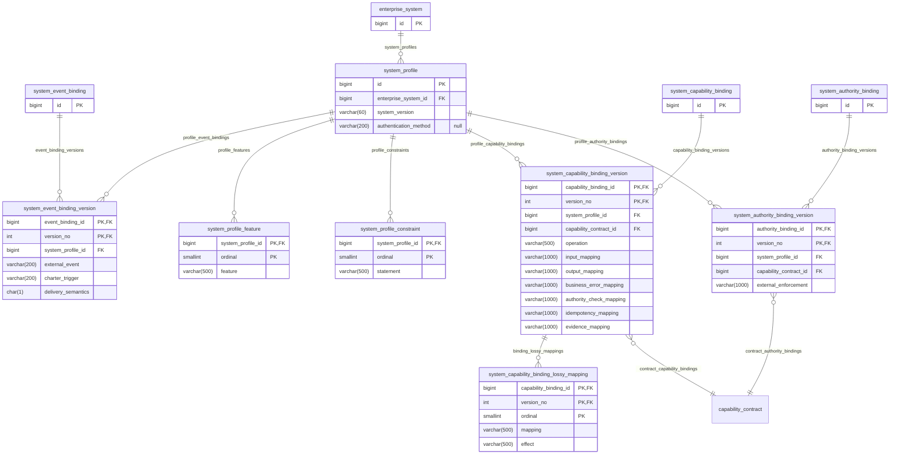

| Table name | Description |
|---|---|
| `enterprise_system` | An external system participating through profiles and bindings. |
| `system_profile` | A version of an enterprise system, with its authentication method. |
| `system_profile_feature` | A feature a system profile supports, in order. |
| `system_profile_constraint` | An operational constraint of a system profile, in order. |
| `system_capability_binding` | Identity of a capability binding across its versions. |
| `system_capability_binding_version` | One immutable mapping of a capability contract to an external operation of a system profile. |
| `system_capability_binding_lossy_mapping` | A mapping of a capability binding version that loses information, with its effect. |
| `system_authority_binding` | Identity of an authority binding across its versions. |
| `system_authority_binding_version` | One immutable mapping of a capability's authority to external enforcement in a system profile. |
| `system_event_binding` | Identity of an event binding across its versions. |
| `system_event_binding_version` | One immutable mapping of an external event to a Charter trigger, with its delivery semantics. |

### Data bindings and binding conformance

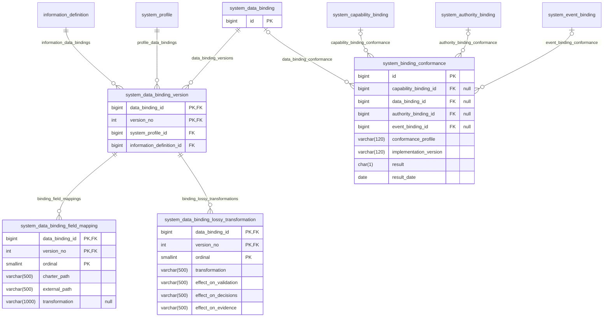

| Table name | Description |
|---|---|
| `system_data_binding` | Identity of a data binding across its versions. |
| `system_data_binding_version` | One immutable mapping of an information definition to a system profile's representation. |
| `system_data_binding_field_mapping` | A field mapping of a data binding version, from Charter path to external path. |
| `system_data_binding_lossy_transformation` | A lossy transformation of a data binding version and its effects on validation, decisions, and evidence. |
| `system_binding_conformance` | Evaluation of one binding against its declared features, with its result. |

- A binding conformance evaluates exactly one binding. A CHECK enforces this.
- Feature support of every binding version, and the evaluated features of a binding conformance, are rows of `binding_feature_support`.
- A binding conformance's tested rules and verification types are rows of the conformance tables.
- `unpreservableConstraintBehavior` is always fail-closed and is written on export.
- The binding-package manifest is an input format for materialization, not a stored document, so it has no table.

| Column | Codes |
|---|---|
| `delivery_semantics` | M at-most-once, L at-least-once, E exactly-once |
| `system_binding_conformance.result` | C conforming, P partial, N nonconforming, shared with conformance claims |

## Information

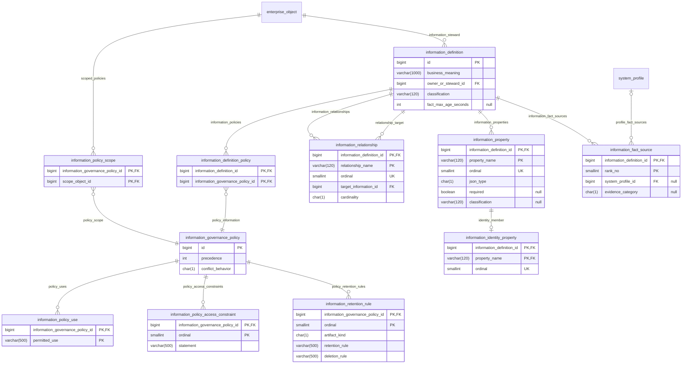

| Table name | Description |
|---|---|
| `information_definition` | Business information: meaning, owner or steward, classification, and maximum fact age. |
| `information_definition_policy` | A governance policy an information definition is subject to. |
| `information_property` | A property of an information definition's shape, with its type and classification. |
| `information_identity_property` | A property that identifies an instance of an information definition. |
| `information_relationship` | A named relationship from an information definition to another, with its cardinality. |
| `information_fact_source` | A ranked source of facts for an information definition: a system profile or an evidence category. |
| `information_governance_policy` | A governance policy for information, with its precedence and conflict behavior. |
| `information_policy_scope` | An object a governance policy applies to. |
| `information_policy_use` | A use a governance policy permits. |
| `information_policy_access_constraint` | An access constraint statement of a governance policy, in order. |
| `information_retention_rule` | Retention and deletion rules a governance policy sets for one kind of artifact. |

- A definition has a shape exactly when it has property rows, and a fact authority exactly when it has fact source rows. `fact_max_age_seconds` requires fact sources.
- A shape's identity names its own properties, so identity members are a foreign key to `information_property`.
- A fact source is exactly one of a system profile or an evidence category. A CHECK enforces this.

| Column | Codes |
|---|---|
| `information_property.json_type` | the `json_type` list without Z null |
| `cardinality` | O one, M many |
| `evidence_category`, shared with evidence records | O observed-fact, A agent-assertion, H human-decision, X external-response, D derived-conclusion |
| `conflict_behavior` | C fail-closed, P apply-declared-precedence |
| `artifact_kind` | S source-data, A action-evidence, P prompt, I intermediate-artifact, C cache, E external-reference |

## Mediation

### Profiles

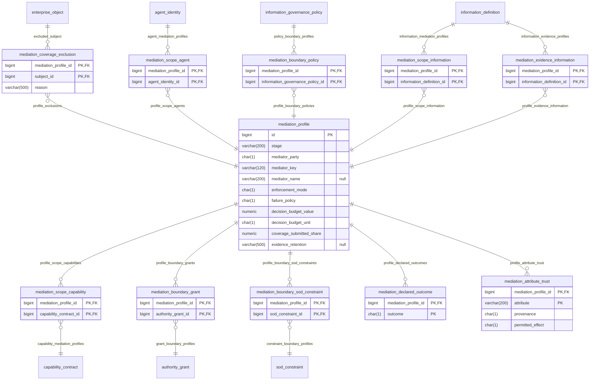

| Table name | Description |
|---|---|
| `mediation_profile` | A mediator at a stage: party, enforcement mode, failure policy, decision budget, and coverage. |
| `mediation_scope_agent` | An agent identity a mediation profile covers. |
| `mediation_scope_capability` | A capability contract a mediation profile covers. |
| `mediation_scope_information` | An information definition a mediation profile covers. |
| `mediation_declared_outcome` | An outcome a mediation profile may decide. |
| `mediation_coverage_exclusion` | An object excluded from a mediation profile's coverage, with the reason. |
| `mediation_attribute_trust` | How far a mediation profile trusts one attribute, by provenance and permitted effect. |
| `mediation_evidence_information` | An information definition a mediation profile records as evidence. |
| `mediation_boundary_grant` | An authority grant that bounds a mediation profile. |
| `mediation_boundary_sod_constraint` | A separation of duties constraint that bounds a mediation profile. |
| `mediation_boundary_policy` | A governance policy that bounds a mediation profile. |

- `mediator.mediatorId` identifies the mediator to the profile's own records and is not a document reference, so it is stored as `mediator_key`.
- An asserted attribute may only tighten. A CHECK enforces this.
- `boundaryControlIds` is split by target kind into three tables.

### Decisions

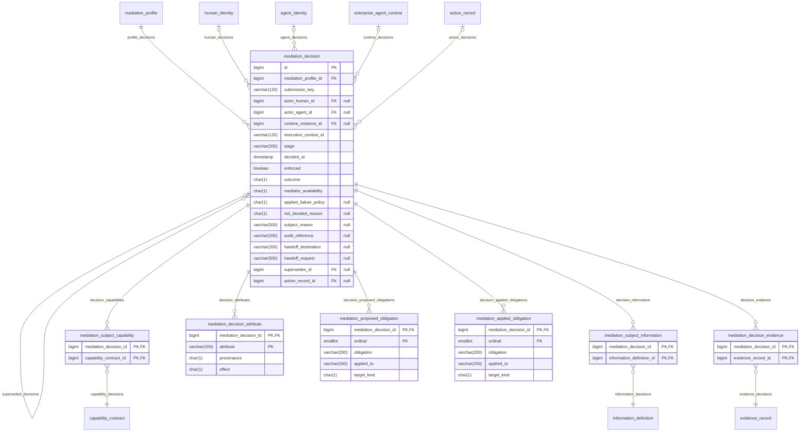

| Table name | Description |
|---|---|
| `mediation_decision` | A decision taken at a mediation profile on one submission, with the profile's values in force at the time. |
| `mediation_subject_capability` | A capability contract a mediation decision concerns. |
| `mediation_subject_information` | An information definition a mediation decision concerns. |
| `mediation_applied_obligation` | An obligation a mediation decision applied, and to what. |
| `mediation_proposed_obligation` | An obligation a mediation decision proposed, and to what. |
| `mediation_decision_attribute` | An attribute a mediation decision used, with its provenance and effect. |
| `mediation_decision_evidence` | An evidence record a mediation decision rests on. |

- A decision's actor is exactly one human or agent. A CHECK enforces this. The runtime is optional, so an agent actor is stored, and when a runtime is present the service refuses an actor other than its identity.
- A non-allow outcome carries an audit reference and a subject reason (CHR-MED-004). The handoff destination and request are all or none. CHECKs enforce both.
- `stage`, `enforced`, and `applied_failure_policy` record the profile's values when the decision was made. The profile is mutable, so they are facts of the decision.
- `actEffective` and `authorityExpanded` are always false and are written on export.
- A decision is a record of what happened. It is written once, and a correction supersedes it.

| Column | Codes |
|---|---|
| `mediator_party` | E enterprise, P platform, T third-party |
| `enforcement_mode` | E enforce, S shadow |
| `failure_policy`, `applied_failure_policy` | C fail-closed, O fail-open, B observe |
| `decision_budget_unit` | M millisecond, S second |
| `outcome`, `mediation_declared_outcome.outcome` | A allow, D deny, M modify, K ask, F defer, N not-decided; profiles declare all except N |
| `mediator_availability` | A available, U unavailable, B budget-exceeded, N undecidable |
| `not_decided_reason` | S out-of-scope, E excluded, N not-sampled, U mediator-unavailable |
| `provenance` | A authenticated, S asserted |
| `permitted_effect` | T tighten-only, R relax-or-tighten |
| `mediation_decision_attribute.effect` | T tightened, R relaxed, N none |
| `target_kind` | A act, D decision |

## Evidence

Evidence is append-only. Rows are inserted once and never updated or deleted, and a correction supersedes the record it corrects.

### Evidence records, exceptions, escalations, and bundles

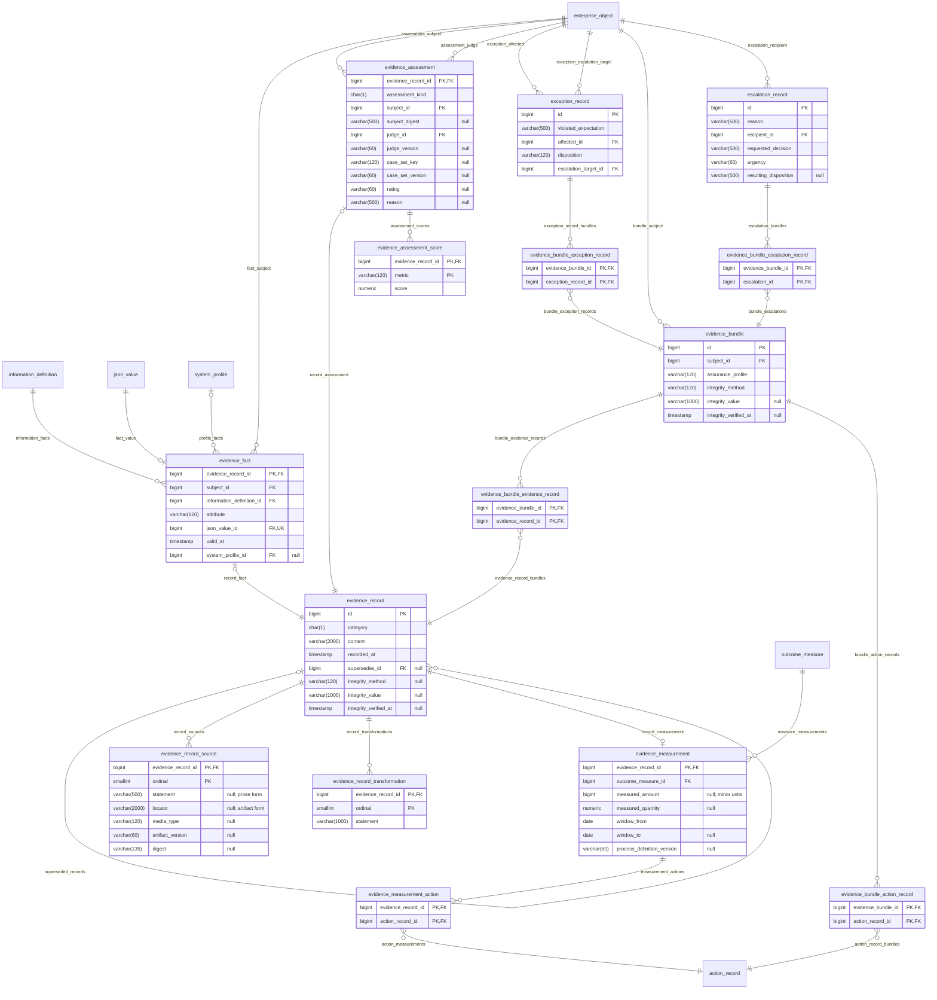

| Table name | Description |
|---|---|
| `evidence_record` | An append-only evidence record: category, content, integrity, and the record it supersedes. |
| `evidence_record_source` | A source of an evidence record, as prose or an artifact version with its digest. |
| `evidence_record_transformation` | A transformation applied to an evidence record's content, in order. |
| `evidence_assessment` | An evaluation or feedback an evidence record carries about a subject, with its judge. |
| `evidence_assessment_score` | A metric score of an evidence assessment. |
| `evidence_fact` | A fact an evidence record states: a subject's information attribute, its value, and when it held. |
| `evidence_measurement` | A measurement an evidence record carries for an outcome measure over a time window. |
| `evidence_measurement_action` | An action record a measurement counts. |
| `exception_record` | A recorded deviation from an expectation, its disposition, and its escalation target. |
| `escalation_record` | A recorded escalation: reason, recipient, requested decision, and urgency. |
| `evidence_bundle` | A set of records about one subject under an assurance profile, with its chained integrity. |
| `evidence_bundle_evidence_record` | An evidence record in a bundle. |
| `evidence_bundle_action_record` | An action record in a bundle. |
| `evidence_bundle_exception_record` | An exception record in a bundle. |
| `evidence_bundle_escalation_record` | An escalation record in a bundle. |

- A source is exactly one of prose or an artifact with locator, media type, version, and digest. A CHECK enforces this.
- An evaluation has a subject digest, a case set, and scores. Feedback has a rating and a reason. A human judge's assessment is a human-decision record, and otherwise it is an agent assertion or a derived conclusion. The service enforces these because they span tables.
- A measurement uses the amount column when its measure has a currency, and the quantity column otherwise. Exactly one is set. A CHECK enforces the second rule, and the service enforces the first because the currency is on the measure.
- `recordIds` is split by target kind into four tables.

### Action records

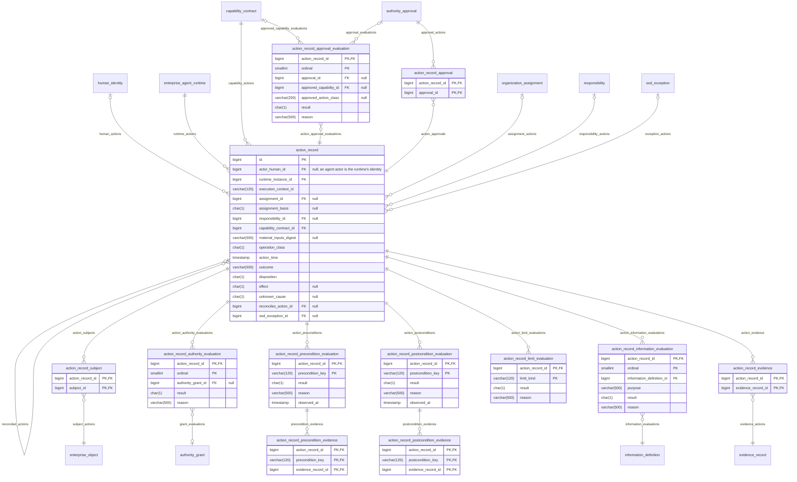

| Table name | Description |
|---|---|
| `action_record` | Evidence of one action by a runtime or human under a capability contract, with its outcome and effect. |
| `action_record_subject` | An object an action acted on. |
| `action_record_authority_evaluation` | The result of one authority evaluation for an action, with the grant used. |
| `action_record_approval_evaluation` | The result of one approval evaluation for an action, with the approved capability or action class in force. |
| `action_record_information_evaluation` | The result of one information-use evaluation for an action. |
| `action_record_approval` | An approval an action relied on. |
| `action_record_evidence` | An evidence record an action produced or used. |
| `action_record_precondition_evaluation` | The observed result of one keyed precondition of an action. |
| `action_record_precondition_evidence` | An evidence record supporting a precondition evaluation. |
| `action_record_postcondition_evaluation` | The observed result of one keyed postcondition of an action. |
| `action_record_postcondition_evidence` | An evidence record supporting a postcondition evaluation. |
| `action_record_limit_evaluation` | The result of evaluating one limit kind for an action. |

- An agent's action is performed by its runtime's identity, and the store refuses an agent actor that differs. So only a human actor is stored, and export derives an agent actor from the runtime.
- An approved evaluation names its approval and exactly one of the approved capability or action class, and any other result names neither. A CHECK enforces this. They are the approval's values at the time of the action, which is why they are recorded here.
- `assignment_basis` requires an assignment. The record has an assignment, a responsibility, or both. CHECKs enforce both.

| Column | Codes |
|---|---|
| `evidence_record.category` | the `evidence_category` list |
| `assessment_kind` | E evaluation, F feedback |
| `assignment_basis` | S sole, M matched, C classified, D default |
| `disposition` | E executed, B business-error, D denied, F failed, U unknown |
| `effect` | C complete, P partial, A absent, U unobserved |
| `unknown_cause` | O observation-failed, U unevidenced, C contradictory |
| `action_record_authority_evaluation.result` | A allowed, D denied, M missing, E error |
| `action_record_approval_evaluation.result` | A approved, R rejected, N not-required, M missing, S stale |
| `action_record_information_evaluation.result` | A allowed, D denied, E error |
| precondition and postcondition `result` | S satisfied, V violated, U unknown |
| `action_record_limit_evaluation.result` | W within, E exceeded |

## Conformance

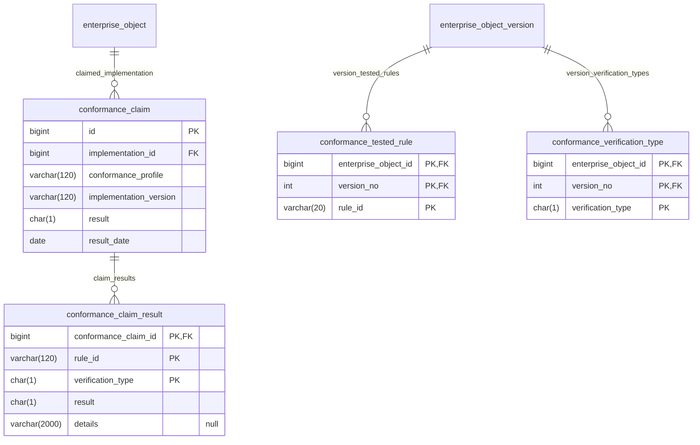

| Table name | Description |
|---|---|
| `conformance_claim` | A bounded conformance claim of an implementation against a profile, with its result. |
| `conformance_claim_result` | The result of one rule under one verification type in a claim. |
| `conformance_tested_rule` | A rule a conformance claim or binding conformance tested. |
| `conformance_verification_type` | A verification type a conformance claim or binding conformance used. |

- Tested rules and verification types belong to the shared claim envelope. They admit the owner kinds BC and CL.
- Rule identifiers name rules of the Charter specification, not tenant data, so they are stored as identifiers rather than foreign keys.

| Column | Codes |
|---|---|
| `result` | C conforming, P partial, N nonconforming |
| `verification_type` | S structural, M semantic, R runtime-behavioral |
| `conformance_claim_result.result` | P pass, F fail, N not-tested |

## Modules

The tables are keel schema modules under `sdk/schema/`: one directory per module with one YAML file per table, and the module's code lists in `seed/<module>.yml`. keel's `schemagen` generates the DDL after keel's `core`, `geo`, and `tenant_management`. A downstream installs any module together with the modules it depends on. `DocumentStore` serves the kinds of the modules it is given and refuses the others.

### Module dependencies

Each module depends only on modules below it, so the module graph has no cycle. The diagram omits dependencies implied by others; the table lists every direct one.

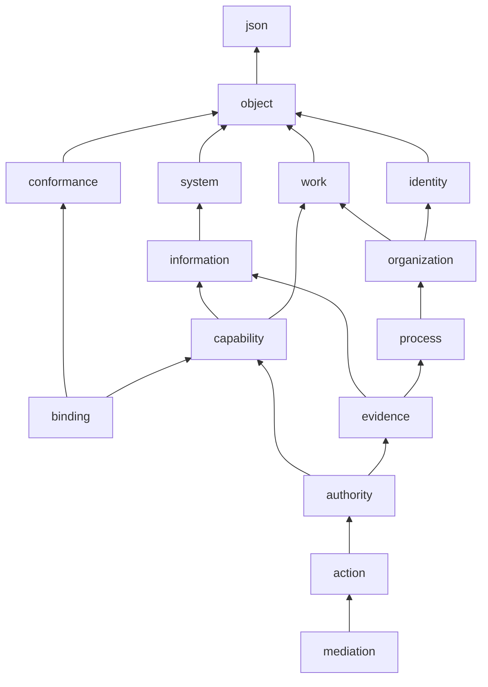

| Module | Tables | Holds | Depends on |
|---|---|---|---|
| `charter_json` | 9 | JSON value trees and embedded JSON Schemas | keel `tenant_management` |
| `charter_object` | 5 | Document identity, version envelope, provenance, extensions, and limits | `charter_json`, keel `geo`, keel `tenant_management` |
| `charter_conformance` | 4 | Conformance claims, and the tested rules and verification types of claims and binding conformance | `charter_object` |
| `charter_identity` | 4 | Human and agent identities, their lifecycle, and account links to keel users | `charter_object`, keel `tenant_management` |
| `charter_system` | 5 | Enterprise systems, system profiles, and the identifiers objects carry in them | `charter_object` |
| `charter_work` | 5 | External work classifications and concepts | `charter_object` |
| `charter_information` | 12 | Information definitions, governance policies, and the evidence requirements of tasks and contracts | `charter_object`, `charter_system` |
| `charter_organization` | 12 | Enterprise, units, positions, roles, responsibilities, relationships, and assignments | `charter_object`, `charter_identity`, `charter_work` |
| `charter_capability` | 10 | Capability contracts and their versions | `charter_json`, `charter_object`, `charter_work`, `charter_information` |
| `charter_process` | 20 | Value streams, processes, tasks, instances, architecture, and outcome measures | `charter_object`, `charter_work`, `charter_organization`, keel `geo` |
| `charter_binding` | 13 | Capability, data, authority, and event bindings, their feature support, and binding conformance | `charter_object`, `charter_conformance`, `charter_system`, `charter_information`, `charter_capability` |
| `charter_evidence` | 9 | Evidence records, the evidence documents cite, and measure baselines | `charter_json`, `charter_object`, `charter_system`, `charter_information`, `charter_process` |
| `charter_authority` | 20 | Agent definitions and runtimes, grants, approvals, separation of duties, and contracts' SoD constraints | `charter_object`, `charter_identity`, `charter_organization`, `charter_capability`, `charter_evidence` |
| `charter_action` | 20 | Action records, exceptions, escalations, bundles, and the actions measurements count | `charter_object`, `charter_identity`, `charter_information`, `charter_organization`, `charter_capability`, `charter_evidence`, `charter_authority` |
| `charter_mediation` | 18 | Mediation profiles and decisions | `charter_object`, `charter_identity`, `charter_information`, `charter_capability`, `charter_evidence`, `charter_authority`, `charter_action` |

`charter_binding` depends on `charter_conformance` without a foreign key: a binding conformance's tested rules and verification types are rows of the conformance tables.

### Tables in a higher module than their owner

A table belongs to the module of the table it references, not of its owner, when the owner's module lies lower. It stays a child of its owner through a real foreign key. A document whose property maps to such a table needs that module: without it, the property must be absent, and a required list is written empty.

| Table | Module | Owner |
|---|---|---|
| `enterprise_object_external_identifier` | `charter_system` | `enterprise_object_version` |
| `evidence_requirement` | `charter_information` | `enterprise_object_version` |
| `binding_feature_support` | `charter_binding` | `enterprise_object_version` |
| `conformance_tested_rule` | `charter_conformance` | `enterprise_object_version` |
| `conformance_verification_type` | `charter_conformance` | `enterprise_object_version` |
| `enterprise_object_source_evidence` | `charter_evidence` | `enterprise_object_version` |
| `outcome_measure_baseline_evidence` | `charter_evidence` | `outcome_measure` |
| `capability_contract_sod_constraint` | `charter_authority` | `capability_contract_version` |
| `evidence_measurement_action` | `charter_action` | `evidence_measurement` |

### Module tables

| Module | Tables |
|---|---|
| `charter_json` | `json_value`, `json_schema_node`, `json_schema_type`, `json_schema_required`, `json_schema_dependent_required`, `json_schema_enum`, `json_schema_example`, `json_schema_vocabulary`, `json_schema_annotation` |
| `charter_object` | `enterprise_object`, `enterprise_object_version`, `enterprise_object_provenance`, `enterprise_object_extension`, `enterprise_object_limit` |
| `charter_conformance` | `conformance_claim`, `conformance_claim_result`, `conformance_tested_rule`, `conformance_verification_type` |
| `charter_identity` | `human_identity`, `agent_identity`, `identity_lifecycle_transition`, `human_identity_partner_user` |
| `charter_system` | `enterprise_system`, `system_profile`, `system_profile_feature`, `system_profile_constraint`, `enterprise_object_external_identifier` |
| `charter_work` | `work_classification`, `work_concept`, `work_concept_label`, `work_concept_broader`, `work_concept_related` |
| `charter_information` | `information_definition`, `information_property`, `information_identity_property`, `information_relationship`, `information_fact_source`, `information_governance_policy`, `information_policy_scope`, `information_policy_use`, `information_policy_access_constraint`, `information_retention_rule`, `evidence_requirement`, `information_definition_policy` |
| `charter_organization` | `enterprise`, `organization_unit`, `position_type`, `position`, `organization_role`, `responsibility`, `organization_relationship`, `organization_role_responsibility`, `responsibility_concept`, `organization_assignment`, `organization_assignment_criterion`, `organization_assignment_criterion_value` |
| `charter_capability` | `capability_contract`, `capability_contract_version`, `capability_contract_input`, `capability_contract_output`, `capability_contract_outcome`, `capability_contract_business_error`, `capability_contract_precondition`, `capability_contract_postcondition`, `capability_contract_postcondition_outcome`, `capability_contract_concept` |
| `charter_process` | `value_stream`, `business_process`, `business_process_version`, `business_process_alias`, `process_task`, `process_task_version`, `process_task_performer_kind`, `process_task_participation`, `process_task_concept`, `process_relationship`, `process_instance`, `process_instance_context`, `architecture_state`, `architecture_gap`, `architecture_gap_compared_element`, `architecture_roadmap_item`, `architecture_roadmap_item_gap`, `architecture_roadmap_item_dependency`, `outcome_measure`, `process_task_instance` |
| `charter_binding` | `binding_feature_support`, `system_capability_binding`, `system_capability_binding_version`, `system_capability_binding_lossy_mapping`, `system_authority_binding`, `system_authority_binding_version`, `system_event_binding`, `system_event_binding_version`, `system_data_binding`, `system_binding_conformance`, `system_data_binding_version`, `system_data_binding_field_mapping`, `system_data_binding_lossy_transformation` |
| `charter_evidence` | `evidence_record`, `evidence_record_source`, `evidence_record_transformation`, `evidence_assessment`, `evidence_assessment_score`, `evidence_fact`, `evidence_measurement`, `enterprise_object_source_evidence`, `outcome_measure_baseline_evidence` |
| `charter_authority` | `enterprise_agent_definition`, `enterprise_agent_definition_version`, `enterprise_agent_definition_responsibility`, `enterprise_agent_definition_trigger`, `enterprise_agent_definition_required_input`, `enterprise_agent_definition_expected_outcome`, `enterprise_agent_definition_policy`, `enterprise_agent_definition_escalation_condition`, `enterprise_agent_definition_confidence_boundary`, `enterprise_agent_runtime`, `sod_constraint`, `sod_constrained_responsibility`, `sod_exception`, `enterprise_agent_definition_capability`, `authority_grant`, `authority_approval`, `authority_approval_subject`, `authority_approval_condition`, `sod_constrained_capability`, `capability_contract_sod_constraint` |
| `charter_action` | `exception_record`, `escalation_record`, `evidence_bundle`, `evidence_bundle_evidence_record`, `evidence_bundle_exception_record`, `evidence_bundle_escalation_record`, `action_record`, `action_record_subject`, `action_record_authority_evaluation`, `action_record_approval_evaluation`, `action_record_information_evaluation`, `action_record_approval`, `action_record_evidence`, `action_record_precondition_evaluation`, `action_record_precondition_evidence`, `action_record_postcondition_evaluation`, `action_record_postcondition_evidence`, `action_record_limit_evaluation`, `evidence_measurement_action`, `evidence_bundle_action_record` |
| `charter_mediation` | `mediation_profile`, `mediation_scope_agent`, `mediation_scope_capability`, `mediation_scope_information`, `mediation_declared_outcome`, `mediation_coverage_exclusion`, `mediation_attribute_trust`, `mediation_evidence_information`, `mediation_boundary_sod_constraint`, `mediation_boundary_policy`, `mediation_boundary_grant`, `mediation_decision`, `mediation_subject_capability`, `mediation_subject_information`, `mediation_applied_obligation`, `mediation_proposed_obligation`, `mediation_decision_attribute`, `mediation_decision_evidence` |

### Seeds

Each module seeds the keel `constant_header` and `constant_value` rows of the code lists it owns and the `constant_lookup` rows of its own columns. A list two modules use belongs to the lower one: `charter_evidence_category` to `charter_information`, `charter_conformance_result` to `charter_conformance`, and `charter_operation_class` to `charter_capability`. `charter_kind` stays whole in `charter_object`, so `enterprise_object.kind` admits every kind code whichever modules are installed. Every `CHAR(1)` and `CHAR(2)` column has a lookup row and a CHECK listing exactly its list's codes, and a test asserts the two agree.

### Names

Three names the diagrams do not show are regular. A kind table's link to `enterprise_object` is `object_<table>`. A version table's link to `enterprise_object_version` is `<table>_envelope`. A non-key foreign key has a plain index named `<foreign key>_ix`, so an index name is as unique as the foreign key name it comes from.

## Table count

| Module | Tables |
|---|---|
| Core | 9 |
| JSON values and JSON Schema | 9 |
| Enterprise | 12 |
| Work | 5 |
| Agent | 23 |
| Process | 32 |
| Binding | 16 |
| Information | 11 |
| Mediation | 18 |
| Evidence | 27 |
| Conformance | 4 |
| Total | 166 |

`business_partner`, `partner_user`, and `currency` are keel tables and are not counted. `sdk/schema/` defines exactly these 166 tables.

## Open points for review

1. **Supertype name.** The identity table is named `enterprise_object`, after the user-facing term for these types. The work vocabulary, bindings, and conformance claims are not enterprise-scoped, so another name may read better.
2. **Rules this model adds to saving.** The store refuses a change of an agent definition's identity across versions, a change of a runtime's definition, an agent action or decision whose actor is not its runtime's identity, and an instance or runtime whose version label names no stored version. The specification implies each rule. The validator checks the actor rules and none of the version labels, so it should gain the version checks for the two sources to agree.
3. **Natural keys for unordered lists.** Feature support, assignment criteria, attribute trust, decision attributes, condition evaluations, and limit evaluations are keyed by their natural member. A document that repeats one is refused, although the JSON Schema alone would accept it.
4. **Canonical form.** An optional empty array or object is exported as absent, and a required empty array as empty. A re-import of the original is still a replay.
5. **History of mutable kinds.** Updates replace their rows through named SQL, which keel's table change logger does not see, so no history of a mutable kind is kept. The store should log the replaced rows through `port.TableLogger` when one is composed. Definition versions stay immutable.
6. **Labels that stay text.** A measurement's `processDefinitionVersion` names a version of its measure's subject, which may be a process or a task. A condition evaluation's key names a precondition or postcondition of a contract version that the action record does not pin. Both stay text because neither target is determined by the row.
7. **Approved action in the JSON schema.** `authority_approval` and the approval evaluation store a capability reference or an action class, never an ambiguous string. The schema's `approvedAction` on Approval and on approval evaluations should split into `approvedCapabilityId` and `approvedActionClass` with exactly one present, so an import does not resolve a string to decide which it is and the separation of duties rule stops matching classes as capabilities.
