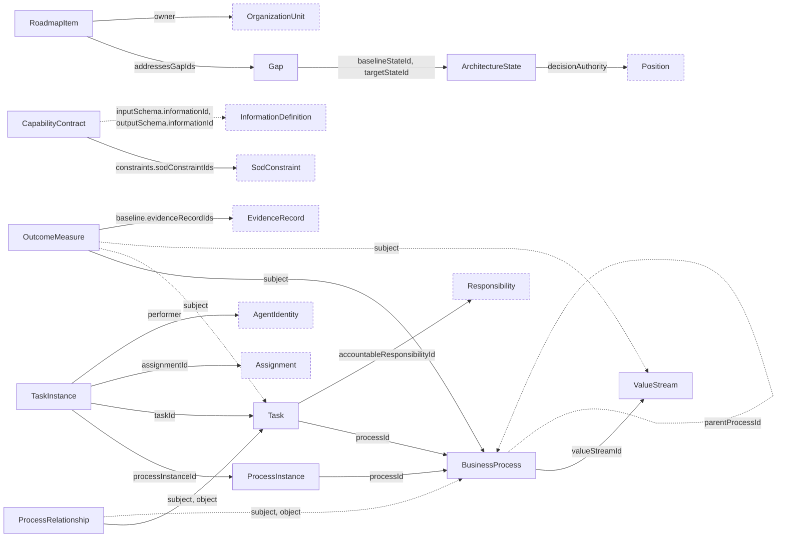

# Process and Capability Schemas

Schemas for the `CHR-PROC`, `CHR-CAP`, and `CHR-ARCH` domains: `value_stream`, `business_process`, `task`, `process_relationship`, `process_instance`, `task_instance`, `capability_contract`, `architecture_state`, `gap`, `roadmap_item`, and `outcome_measure`.

Definition and instance documents are separate. Execute contracts must declare idempotency; target architecture states must name their decision authority. Definition documents may cite their `sourceEvidence` (CHR-INFO-009), and a task instance's participation never exceeds its assignment's level (CHR-PROC-008). An agent performs a measured task above `recommends` only under an assignment that began after each measure in effect was baselined (CHR-PROC-009). A task instance not started by its `dueAt` is escalated to its task's accountable authority (CHR-PROC-010). A capability contract may type its inputs and outputs in `inputSchema` and `outputSchema`, by an information shape or an embedded JSON Schema (CHR-CAP-011), and its preconditions and postconditions may carry a `predicate` in CEL; a precondition with a predicate is an object with an `id` (CHR-CAP-012).

## Relations

Dashed nodes belong to other domains.