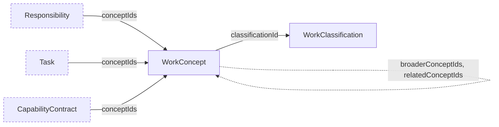

# Work Vocabulary Schemas

Schemas for the work vocabulary of the `CHR-ENT` domain: `work_classification` and `work_concept`.

A classification is one version of an external taxonomy of work, with its publisher, location, and license terms; a concept is one of its terms with the identifier it carries there, labels by language, and broader and related concepts of the same classification. Responsibilities, tasks, and capability contracts cite concepts in `conceptIds` to say what work they are in a shared vocabulary; a citation confers nothing (CHR-ENT-014). Classifications are shared catalogs, not enterprise-scoped, and Charter never carries a classification's full content.

## Relations

Dashed nodes belong to other domains.
